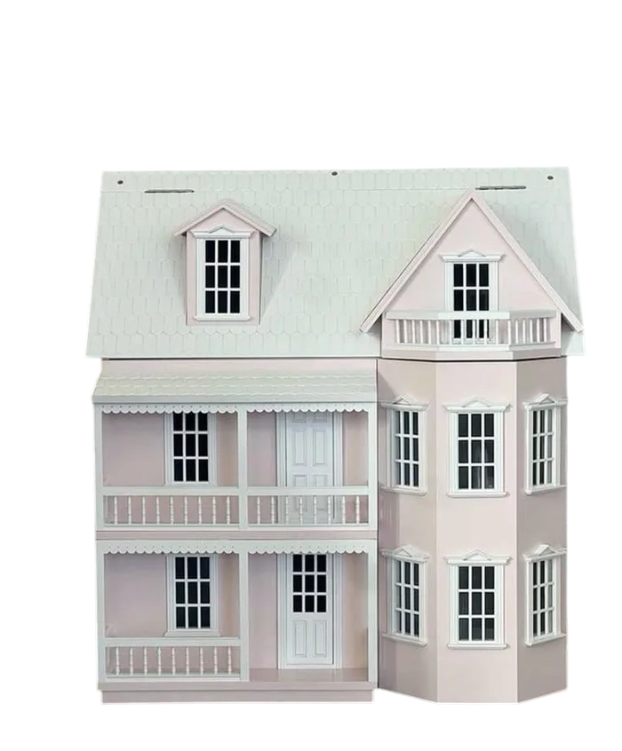
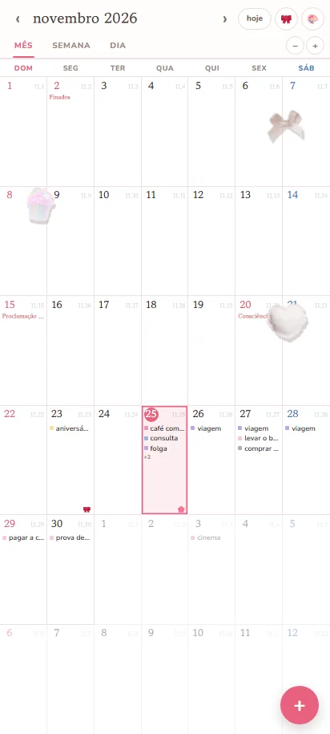
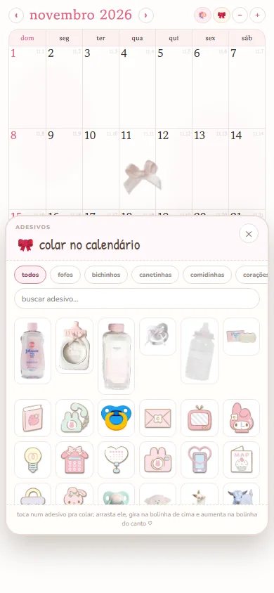

<p align="center">
  
</p>

<h1 align="center">little pause ୨୧</h1>

<p align="center">
  <em>um cantinho no Android para respirar entre um app e outro</em>
</p>

<p align="center">
  
</p>

O **little pause** é um app de controle de uso — daqueles que seguram os aplicativos que a gente abre sem
perceber. Ele nasceu de um incômodo bem simples: os bloqueadores que existiam eram todos cinzas, com
cadeados, cronômetros e um tom de sermão. Nenhum combinava com a vontade de cuidar do meu tempo de um
jeito gentil. Então esse aqui é do meu jeitinho: porcelana, laço, papel de carta e uma pausa que conversa
com você em vez de brigar.

<p align="center">
  
  &nbsp;&nbsp;
  
  &nbsp;&nbsp;
  
  &nbsp;&nbsp;
  
</p>

<p align="center"><em>um pouco do clima: porcelana, pastel, chá da tarde, sorte pequena</em></p>

---

## o que ele faz

- **pausas por horário** — escolha dias, hora de começar e de terminar, e quais apps entram na pausa.
  Dá para ter quantas quiser: uma de manhã para o feed, outra à noite para o vídeo antes de dormir.
- **limites diários por app** — um teto de minutos que soma *todas* as sessões do dia. Bateu o limite,
  o app entra na pausa até o dia seguinte.
- **a telinha da pausa** — quando um app bloqueado abre, aparece um cartão calmo com o nome do app,
  um respiro de 15 segundos e dois caminhos: voltar para o seu dia ou continuar por 1 minuto.
- **resumo das 22h** — um bilhetinho com o seu tempo de tela do dia e uma comparação com filmes de 1h40.
- **recadinhos** — lembretes com data e hora, para não esquecer o que importa.
- **um calendário inteiro** — o mesmo calendário que eu fiz para o *little place*, morando aqui dentro:
  tarefinhas coloridas, carinhas do dia, eventos de vários dias, foto do dia e muitos adesivos.

## o calendário

<p align="center">
  
  &nbsp;&nbsp;
  
</p>

O calendário é a parte mais bonita e a mais pessoal do app. Ele veio do **little place** — um caderninho
que eu fiz para mim e que virou o meu lugar preferido para escrever. A ideia era simplesmente copiar
aquele código para cá, sem inventar moda, porque ele já estava do jeitinho que eu gosto.

- **tarefinhas** — cada linha vira uma fitinha colorida no dia, e elas atravessam a semana quando o
  evento é longo.
- **carinhas do dia** — um emoji para marcar o clima daquele dia.
- **eventos de vários dias** — viagem, prova, aniversário: escolhe a cor e a faixa se estica pelo calendário.
- **foto do dia** — uma fotinha preenche o quadradinho do dia.
- **meu calendário 🎨** — fundo (bolinhas, nuvens, xadrez, papel, a sua própria foto), estilo dos
  quadradinhos, cor de cada detalhe, sete letras diferentes e o numerinho do lado (dia do ano, semana,
  data curtinha).
- **caixinha de adesivos 🎀** — 899 adesivos guardados no próprio APK, em categorias
  (lacinhos, natureza, pelúcias, comidinhas, rendinhas…). Toca para colar, arrasta para o cantinho,
  gira e aumenta nas bolinhas. Ele também aceita uma imagem da galeria.

Tudo isso **funciona sem internet**: as fontes, os adesivos e a página do calendário vivem dentro do
aplicativo. E os seus dias ficam só no seu celular.

<p align="center">
  
</p>

## as asinhas (ou: o Android não vai cortar)

Um app que fica de vigia tem um inimigo silencioso: a economia de bateria do Android. Quando a tela
apaga, o sistema costuma fechar quem está monitorando — e aí a pausa simplesmente… some.

O little pause se defende disso com carinho e sem exagero:

- ele roda como **serviço em primeiro plano**, com uma notificação discreta;
- pede para **sair da otimização de bateria** — com um cartão explicando por quê, e um botão que
  leva direto para a tela certa do seu Android;
- **volta sozinho** depois de reiniciar o celular ou de se atualizar;
- tem um **lembrete silencioso a cada 15 minutos** que reacende o bloqueio se ele tiver cochilado;
- se você deslizar o app para fora da lista de recentes, a pausa continua de pé.

E existe o outro lado: **não ser tão irrestrito a ponto de dar vontade de burlar**.

- a telinha da pausa tem um **respiro de 15 segundos** antes dos botões acenderem;
- “continuar por 1 minutinho” existe, mas **cada fuga aumenta o respiro da próxima** (até 45 segundos);
- desligar a pausa pela tela inicial pede uma **confirmação com contagem** — não é um toque distraído.

Nada de administrador de dispositivo, nada de esconder o próprio ícone, nada de mexer nas suas
configurações ou bloquear o acesso aos ajustes do Android. O que segura você aqui é o combinado que
você fez com você mesma — não uma coleira.

## instalação

Baixe o APK mais recente em **[releases](https://github.com/sorodeleite/little-pause/releases/latest)**
(`little-pause.apk`) e instale. O próprio app consegue procurar e baixar atualizações depois.

Depois de abrir, o app pede três licenças, cada uma com um motivo:

| licença | para quê |
| --- | --- |
| acesso ao uso dos apps | saber qual aplicativo está na sua frente |
| sobrepor outros apps | mostrar a telinha da pausa |
| notificações | o resumo das 22h e o aviso de pausa ativa |

E, na tela **pausas**, um cartão para liberar a bateria — o tal do “não cortar as asinhas”.

## por dentro

- **Kotlin + Jetpack Compose** para a interface e para os cartões;
- **UsageStatsManager** para descobrir o app em primeiro plano — sem acessibilidade, sem root;
- **um WebView** com a página do calendário servida de dentro do APK (`app/src/main/assets/calendar`),
  com fontes e adesivos guardados junto;
- tudo em português, tudo offline, sem conta, sem anúncios e sem servidor.

```
app/src/main/
  java/com/littlepause/
    MainActivity.kt · HomeScreen.kt · CalendarScreen.kt · PauseScreen.kt
    AppBlockingService.kt · KeepAlive.kt · BlockSchedules.kt · AppDailyLimitsCard.kt
    Reminders.kt · DailyUsageReceiver.kt · AppUpdater.kt
  assets/calendar/
    index.html · planner.js · calendar.css · calendar-style.js · calendar-events.js
    fonts/ · stickers/ · sticker-manifest.js
```

### para publicar uma versão nova

1. suba o `versionCode` e o `versionName` em `app/build.gradle.kts`;
2. crie a tag e empurre: `git tag v0.5.0 && git push origin v0.5.0`;
3. o workflow **Android release** monta o APK assinado e publica em *releases* com o nome
   `little-pause.apk` — é exatamente esse arquivo que o app procura quando você toca em
   “procurar atualização”.

Todo push em `app/**` na `main` também monta um APK de teste no workflow **Android build**, sem publicar nada.

## privacidade

O little pause não tem conta, não manda nada para lugar nenhum e não tem anúncios. Os nomes dos apps,
os horários, os limites, as tarefinhas e as fotinhas do calendário ficam guardados no seu aparelho.
O único acesso à internet é para procurar uma versão nova no GitHub quando você toca em
“procurar atualização”.

## um lembrete

Ferramenta de autocuidado não é prova de disciplina. Se um dia a pausa atrapalhar mais do que ajudar,
desligue sem culpa, ajuste os horários e volte depois. A ideia é sempre essa: **slow down, you're doing
fine.**

<p align="center">
  
</p>

<p align="center"><em>feito com carinho, para os seus dias ♡</em></p>
